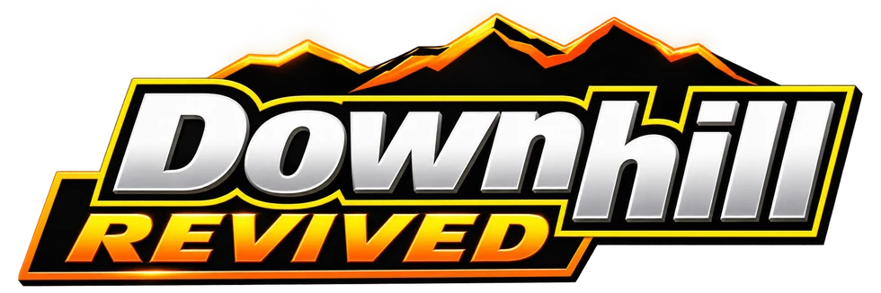
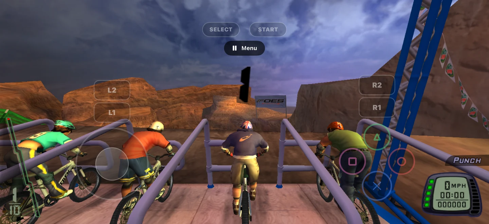
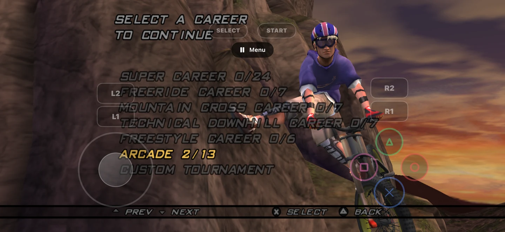
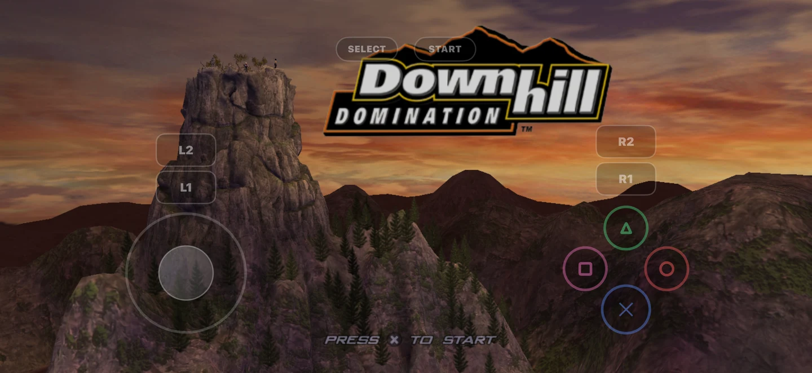
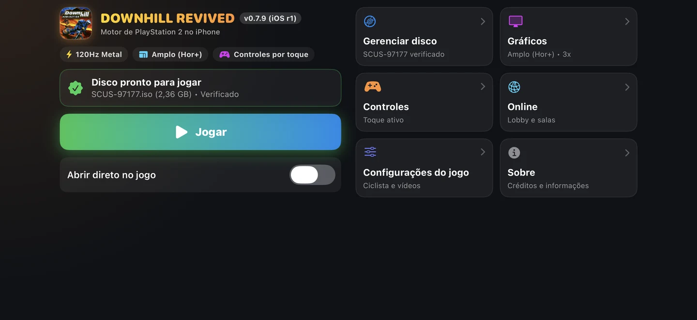
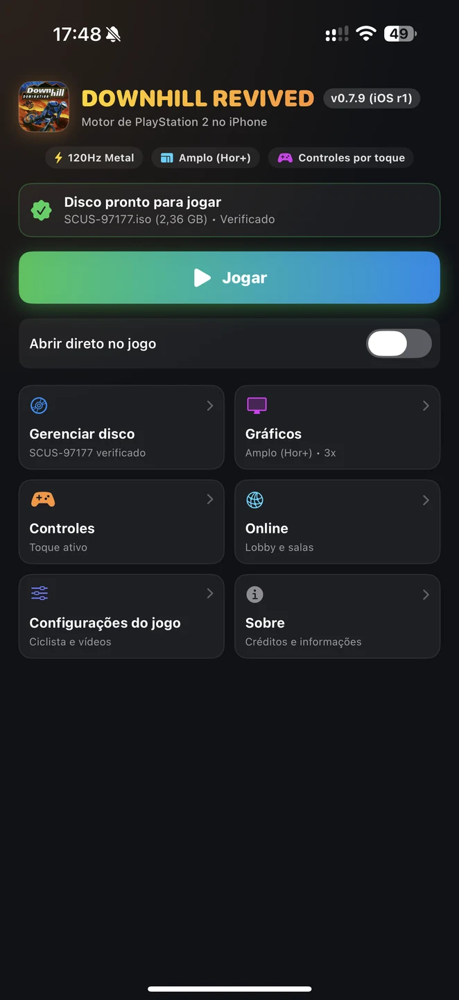
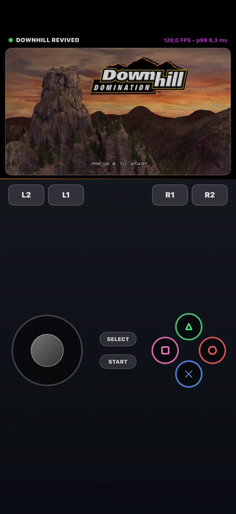

<p align="center">
  
</p>

<h1 align="center">Downhill Revived for iOS</h1>

<p align="center">
  <strong>The downhill rush, now on iPhone and iPad.</strong><br>
  An independent native iOS fork of <a href="https://github.com/skuza-oss/downhill-revived">Downhill Revived</a>.
</p>

<p align="center">
  
  
  
  
</p>

<p align="center">
  <a href="README.pt-BR.md">Português (Brasil)</a> | <strong>English</strong>
</p>

<p align="center">
  <a href="#download">Download</a> ·
  <a href="#highlights">Highlights</a> ·
  <a href="#requirements">Requirements</a> ·
  <a href="#build-an-ipa-with-ai">Build with AI</a> ·
  <a href="#credits-and-legal">Credits</a>
</p>

---

Downhill Revived for iOS brings the open-source **Downhill Revived** project to Apple's mobile devices with a SwiftUI launcher, native Metal rendering, touch controls and external-display support. It is **not an emulator front-end** and is **not affiliated with the original game's rights holders**.

The codebase is based on the work of **[skuza-oss](https://github.com/skuza-oss/downhill-revived)**. Please visit the upstream project for its original PC port, documentation and community.

## Highlights

| Feature | iOS port |
| :--- | :--- |
| **Native rendering** | Metal graphics and an ARM64 native build |
| **High refresh rate** | Configurable play up to 120 FPS on supported 120 Hz devices, subject to performance and power limits |
| **Touch controls** | Virtual buttons and analog control, with configurable layout and sensitivity |
| **Controller support** | Compatible controllers through iOS GameController and SDL, including supported PlayStation and Xbox controllers |
| **TV output** | AirPlay and compatible HDMI external-display paths; on-device behavior depends on the display and adapter |
| **Wide display** | Widescreen presentation and separate TV output handling |
| **Resolution settings** | Adjustable rendering settings, with a default TV output cap of 1080p unless changed before launch |
| **Multilingual launcher** | English, Brazilian Portuguese, Spanish, French, German, Italian, Japanese and Simplified Chinese |
| **Your own game files** | Local import and validation of the original US PlayStation 2 disc image |

> **Development status:** Experimental community port. Features above describe the supplied implementation, not a promise of identical performance on every device. Physical-device testing is still recommended, especially for AirPlay/HDMI, 120 FPS and controller behavior.

## Download

**First iOS release: v0.7.9 (build 70902).** The supplied release artifact is:

`DownhillRevived-iOS-0.7.9-build-70902-unsigned.ipa`

**This IPA is unsigned. It cannot be installed directly on an ordinary iPhone/iPad as-is.** Developers may sign a build with an appropriate Apple team and provisioning profile. Instructions: **[Installation and signing](docs/INSTALLATION.md)**.

Once a release is published, its files will appear in the [repository's Releases section](https://github.com/ribeirogustav/downhill-revived-ios/releases).

**SHA-256 of the unsigned IPA:**

```text
4181572bd7b78ce87e956d52309e0879b3230f82a7511d325a6abd2b50adcc4c
```

The hash above verifies the **exact unsigned 70902 IPA**. Signing, re-packaging or rebuilding changes its checksum. Compare only the matching release filename and see [`SHA256SUMS`](SHA256SUMS).

## Requirements

| Requirement | Minimum / details |
| :--- | :--- |
| **iOS / iPadOS** | **17.0 or newer**, as declared by the IPA |
| **Hardware** | **ARM64 and Metal** support |
| **Space** | Enough free storage for the app and your own game disc image |
| **Game disc image** | **Downhill Domination (USA), SCUS-97177**, unmodified `.iso` from your own disc |
| **Installation** | Valid Apple code signing and provisioning appropriate to the target device |
| **120 FPS** | A supported 120 Hz display and adequate sustained performance; not guaranteed |

**Important distinction:** **iOS 17.0** is the minimum operating system. **SCUS-97177** is the supported game disc/ISO edition. An iOS update will not substitute for the required game `.iso`.

The game content, BIOS, music, movies and disc image are **not distributed** with this project. Users must provide their own legally obtained dump of the supported USA disc.

## Installation

1. Use a compatible iPhone or iPad running iOS/iPadOS 17.0+.
2. Obtain a **signed** build created for your device or distribution method. The provided unsigned IPA alone is not installable.
3. Install it through an authorized Apple development/distribution workflow. Developer Mode may be required for development-signed builds.
4. Start the launcher and import your own **Downhill Domination USA (SCUS-97177)** `.iso`.
5. Configure graphics, touch/controller input and, if appropriate, TV output before launching the game.

Read the full [installation guide](docs/INSTALLATION.md).

## Screenshots and gameplay

### Gameplay video

<p align="center">
  <video src="assets/gameplay.mp4" controls="controls" width="100%" style="max-width: 720px;">
    Your browser does not support video playback.
  </video>
</p>

<p align="center">
  🎬 <em>Captured on a physical iPhone 7 Plus running native Metal at 30/120 FPS.</em><br>
  <a href="assets/gameplay.mp4"><strong>Watch / Download gameplay clip (assets/gameplay.mp4)</strong></a>
</p>

### On-device screenshots

| Gameplay (Racing) | Career Selection |
| :---: | :---: |
|  |  |

| Title Screen & Touch Overlay | Native Launcher (Landscape) |
| :---: | :---: |
|  |  |

| Native Launcher (Portrait) | In-Game Touch Controls (Portrait) |
| :---: | :---: |
|  |  |

## Build an IPA with AI

You can use **ChatGPT, Gemini or Claude** as a coding assistant to understand, prepare, diagnose and adapt the build process. The AI does **not** replace the Apple compiler, an iOS SDK, code signing or the need for your own game disc.

The source already includes a native iOS build script: [`port/ios/build_ios.py`](port/ios/build_ios.py). The complete guide provides setup steps, signed/unsigned examples, verification and a reusable prompt:

**[How to build the IPA with AI](docs/BUILD_IPA_WITH_AI.md)** · **[Guia em português](docs/BUILD_IPA_WITH_AI.pt-BR.md)**

Example (run at the root of a properly prepared project on macOS):

```bash
# Unsigned artifact for inspection; not directly installable
python3 port/ios/build_ios.py --unsigned

# Signed build for your own authorized Apple team
python3 port/ios/build_ios.py --team YOURTEAMID --allow-provisioning-updates
```

These commands require Xcode, XcodeGen, the project toolchains and the locally derived game build inputs. They are not one-command builds on a fresh computer.

## Credits and legal

**Original open-source project:** [Downhill Revived by skuza-oss](https://github.com/skuza-oss/downhill-revived). The underlying decompilation, native-port foundation and original documentation are the work of the upstream project and its contributors. **This repository is an independent community iOS adaptation**, not an official Apple release from the upstream author.

**Original video game:** *Downhill Domination* (2003), associated with Incognito Entertainment, Sony Computer Entertainment America and their respective rights holders. All related trademarks, game assets and intellectual property remain with their owners. No sponsorship, approval or affiliation is claimed.

**Open-source credits:** [upstream credits](docs/CREDITS.md), including SDL, PCSX2, wgpu, WABT and other contributors. iOS touch UI asset acknowledgements include [Kenney](https://kenney.nl) (CC0), as documented in the source.

**License:** The covered source code remains under **[GNU GPL-3.0-or-later](LICENSE)**, with applicable third-party notices preserved. Distribution of binaries must comply with the license, including providing corresponding source code. The GPL does not grant rights to the original game's data or trademarks.

See [legal notes](docs/LEGAL_AND_CREDITS.md). This is not legal advice.

---

<p align="center">
  Built on <a href="https://github.com/skuza-oss/downhill-revived"><strong>Downhill Revived</strong></a> by skuza-oss.<br>
  <sub>Independent iOS fork · Bring your own disc · Preserve the credits</sub>
</p>
