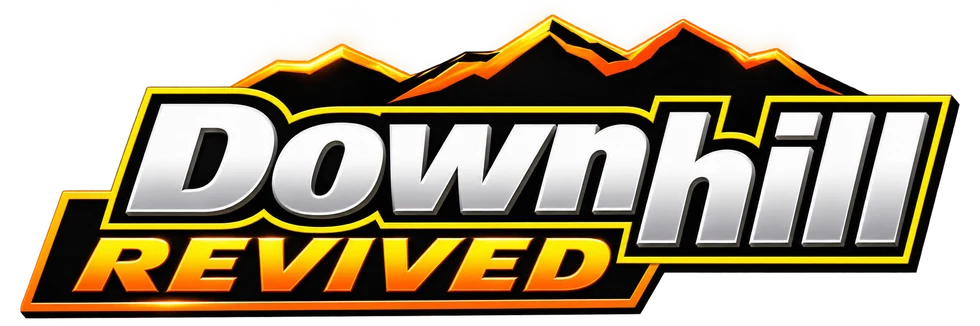
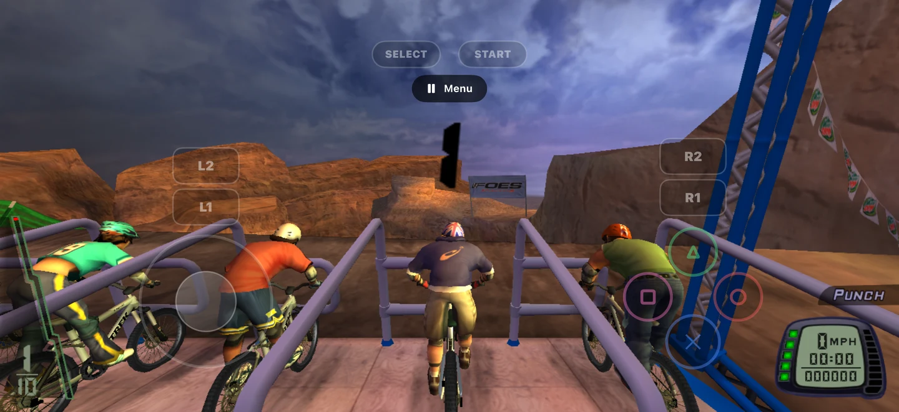
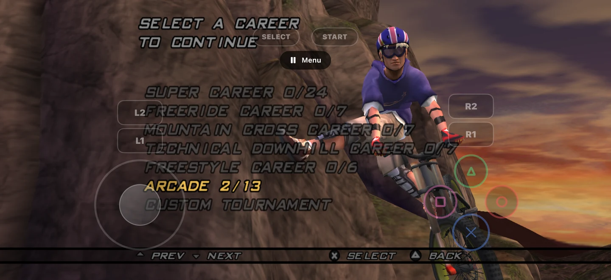
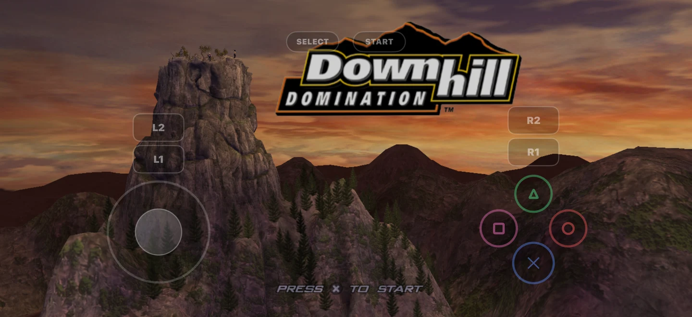
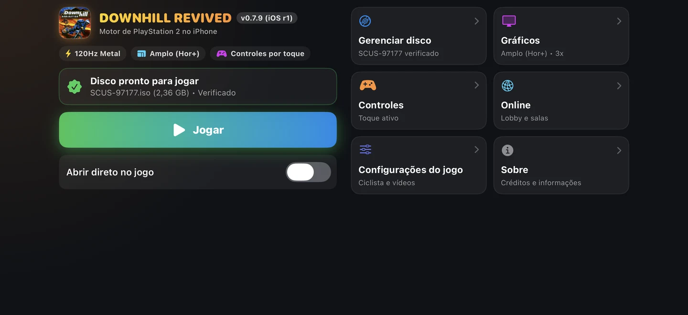
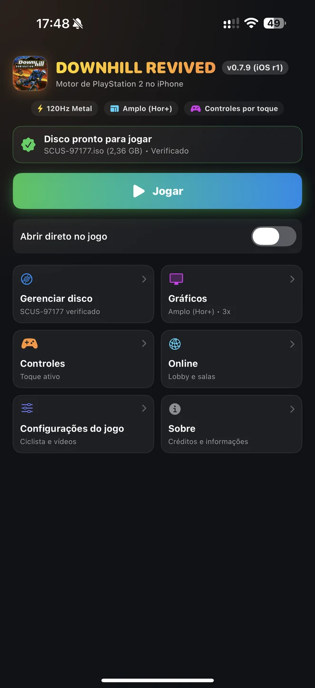
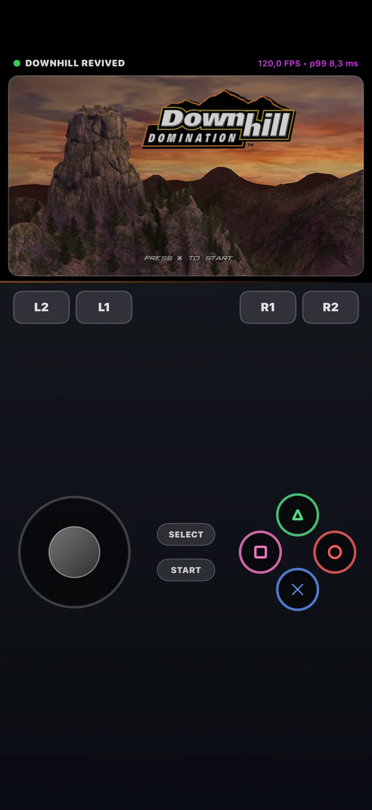

<p align="center">
  
</p>

<h1 align="center">Downhill Revived para iOS</h1>

<p align="center">
  <strong>A adrenalina das descidas, agora no iPhone e iPad.</strong><br>
  Fork independente para iOS do projeto <a href="https://github.com/skuza-oss/downhill-revived">Downhill Revived</a>.
</p>

<p align="center">
  
  
  
  
</p>

<p align="center">
  <strong>Português (Brasil)</strong> | <a href="README.md">English</a>
</p>

<p align="center">
  <a href="#download">Download</a> ·
  <a href="#recursos">Recursos</a> ·
  <a href="#requisitos">Requisitos</a> ·
  <a href="#gerando-um-ipa-com-ia">Gerar IPA com IA</a> ·
  <a href="#créditos-e-licença">Créditos</a>
</p>

---

Este fork leva o projeto de código aberto **Downhill Revived** aos dispositivos Apple, com launcher em SwiftUI, renderização nativa via Metal, controles por toque e suporte a telas externas. Não é um front-end de emulador, e não possui vínculo oficial com os detentores dos direitos do jogo.

Todo o trabalho original de recriação, descompilação e port para computadores tem como base o projeto de **[skuza-oss](https://github.com/skuza-oss/downhill-revived)** e seus colaboradores.

## Recursos

| Recurso | Port para iOS |
| :--- | :--- |
| **Gráficos nativos** | Renderização Metal e compilação ARM64 |
| **Alta taxa de quadros** | Configurações para até 120 FPS em aparelhos de 120 Hz compatíveis, condicionadas ao desempenho |
| **Controles na tela** | Botões e direcional virtual, com ajustes de posição e sensibilidade |
| **Controle físico** | Integração com GameController/SDL e controles compatíveis, incluindo modelos PlayStation e Xbox suportados pelo iOS |
| **TV e monitor** | Caminhos de saída via AirPlay ou HDMI compatível; dependem do receptor e do adaptador |
| **Tela ampla** | Apresentação widescreen, com tratamento dedicado para a TV |
| **Resolução** | Opções de qualidade; saída para TV limitada inicialmente a 1080p, salvo alteração antes do jogo |
| **Idiomas** | Português brasileiro, inglês, espanhol, francês, alemão, italiano, japonês e chinês simplificado no launcher |
| **Jogo original** | Importação local da ISO americana do PlayStation 2 |

> **Status:** versão experimental. Os recursos refletem a implementação do código enviado e não garantem desempenho idêntico em todos os dispositivos. AirPlay, HDMI, controles e 120 FPS devem ser testados em aparelhos reais.

## Download

**Primeira versão para iOS: v0.7.9 (build 70902).** Arquivo disponível para a publicação:

`DownhillRevived-iOS-0.7.9-build-70902-unsigned.ipa`

**Atenção: esse IPA não está assinado digitalmente e não pode ser instalado diretamente em um iPhone comum.** Para instalar, é necessário assinar o aplicativo com credenciais e provisionamento Apple válidos. Leia [instalação e assinatura](docs/INSTALACAO.pt-BR.md).

Após criar a primeira versão, os arquivos estarão em [Releases deste repositório](https://github.com/ribeirogustav/downhill-revived-ios/releases).

**SHA-256 do IPA não assinado:**

```text
4181572bd7b78ce87e956d52309e0879b3230f82a7511d325a6abd2b50adcc4c
```

O hash se refere **somente** a esse arquivo IPA, sem alterações. Uma assinatura ou nova compilação muda o checksum. Consulte [`SHA256SUMS`](SHA256SUMS).

## Requisitos

| Item | Requisito |
| :--- | :--- |
| **iOS / iPadOS** | **17.0 ou superior** |
| **Processador e GPU** | **ARM64 e Metal** |
| **Armazenamento** | Espaço para o app e a imagem de disco do seu próprio jogo |
| **ISO do jogo** | **Downhill Domination USA (SCUS-97177)**, arquivo `.iso` original e não modificado |
| **Instalação** | Assinatura Apple válida e perfil de provisionamento apropriado |
| **120 FPS** | Tela de 120 Hz compatível e desempenho suficiente, sem garantia de taxa fixa |

**Não confunda:** **iOS 17.0** é a versão mínima do sistema operacional; **SCUS-97177** é a edição da ISO do jogo exigida pelo port.

O projeto **não inclui a ISO**, executável original do PS2, BIOS, vídeos, músicas ou outros dados protegidos. O usuário precisa criar seu próprio dump de uma cópia legítima do disco americano.

## Como instalar

1. Tenha um iPhone ou iPad compatível com **iOS/iPadOS 17.0+**.
2. Prepare um aplicativo **assinado** para seu dispositivo. O IPA não assinado disponibilizado para desenvolvimento não instala sozinho.
3. Instale pelo fluxo autorizado de desenvolvimento/distribuição Apple. Em instalações de desenvolvimento, talvez seja necessário ativar o Modo de Desenvolvedor.
4. Abra o launcher e importe sua própria ISO **Downhill Domination USA (SCUS-97177)**.
5. Ajuste gráficos, controles e eventual saída para TV antes de jogar.

Veja o [guia de instalação completo](docs/INSTALACAO.pt-BR.md).

## Imagens e gameplay

### Vídeo de gameplay

<p align="center">
  <video src="assets/gameplay.mp4" controls="controls" width="100%" style="max-width: 720px;">
    Seu navegador não suporta reprodução direta de vídeo.
  </video>
</p>

<p align="center">
  🎬 <em>Demonstração capturada em um iPhone 7 Plus real rodando o motor Metal nativo a 30/120 FPS.</em><br>
  <a href="assets/gameplay.mp4"><strong>Assistir / Baixar vídeo de gameplay (assets/gameplay.mp4)</strong></a>
</p>

### Capturas de tela (dispositivo real)

| Corrida na montanha | Seleção de carreira |
| :---: | :---: |
|  |  |

| Tela inicial e controles widescreen | Launcher nativo (Paisagem) |
| :---: | :---: |
|  |  |

| Launcher nativo (Retrato) | Controles por toque (Retrato) |
| :---: | :---: |
|  |  |

## Gerando um IPA com IA

É possível usar **ChatGPT, Gemini ou Claude** como assistente para ler o código, orientar a compilação, corrigir erros e explicar dependências. A IA **não substitui o macOS, Xcode, SDK do iOS, assinatura digital ou a ISO original**.

O projeto já dispõe do script [`port/ios/build_ios.py`](port/ios/build_ios.py). O passo a passo apresenta tanto a geração sem assinatura quanto a assinatura com uma equipe Apple:

**[Tutorial completo de geração do IPA com IA](docs/BUILD_IPA_WITH_AI.pt-BR.md)** · **[English](docs/BUILD_IPA_WITH_AI.md)**

```bash
# Gera IPA não assinado, apenas para inspeção e desenvolvimento
python3 port/ios/build_ios.py --unsigned

# Compila e assina usando sua própria equipe Apple autorizada
python3 port/ios/build_ios.py --team ABCDEFGHIJ --allow-provisioning-updates
```

Esses comandos exigem Xcode e as ferramentas do projeto instaladas, além dos dados locais derivados do seu próprio disco. Não funcionam isoladamente em uma máquina recém-configurada.

## Créditos e licença

**Projeto base:** [Downhill Revived por skuza-oss](https://github.com/skuza-oss/downhill-revived). A descompilação, as bases do port nativo e a documentação principal pertencem ao trabalho do autor original e demais contribuidores. **Este é um fork independente para iOS**, não uma versão oficial do autor original.

**Jogo original:** *Downhill Domination* (2003), relacionado à Incognito Entertainment, Sony Computer Entertainment America e respectivos titulares. Nomes, marcas e recursos do jogo pertencem aos seus detentores. Não há afiliação, patrocínio ou endosso.

**Terceiros:** consulte os [créditos preservados do projeto original](docs/CREDITS.md), incluindo SDL, PCSX2, wgpu, WABT e colaboradores. As referências aos recursos de toque incluem [Kenney](https://kenney.nl), sob CC0, conforme as notas do código.

**Licença de código:** **[GNU GPL-3.0-or-later](LICENSE)**, com preservação das licenças e avisos de terceiros. A publicação de binários exige cumprir as obrigações da licença, inclusive disponibilizar o código-fonte correspondente. A GPL não dá direito sobre os arquivos ou marcas do jogo comercial.

Consulte [notas jurídicas e créditos](docs/LEGAL_AND_CREDITS.md). Este conteúdo não substitui aconselhamento jurídico.

---

<p align="center">
  Baseado em <a href="https://github.com/skuza-oss/downhill-revived"><strong>Downhill Revived</strong></a>, de skuza-oss.<br>
  <sub>Fork independente para iOS · Use sua própria ISO · Preserve os créditos</sub>
</p>
